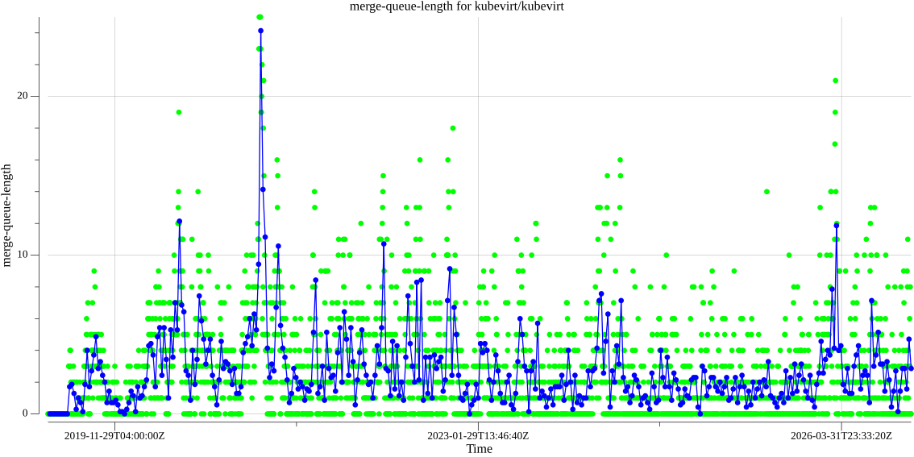
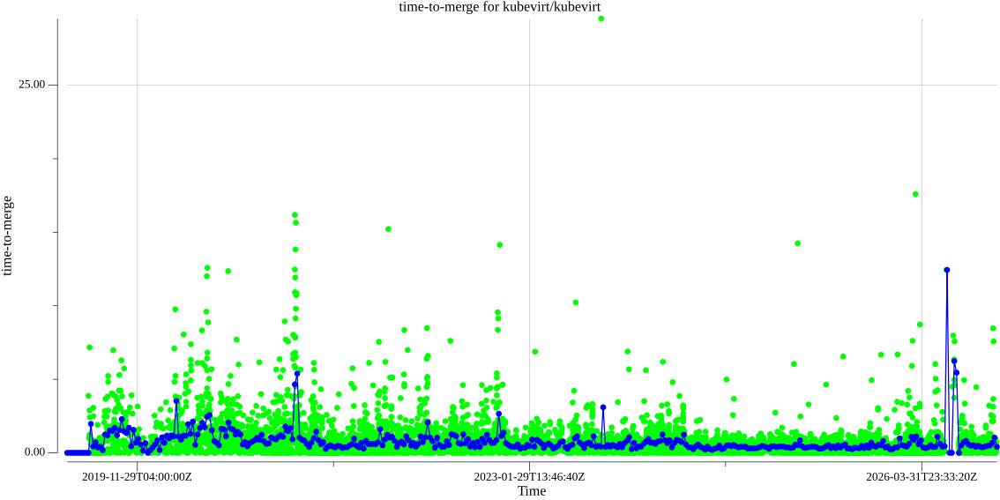
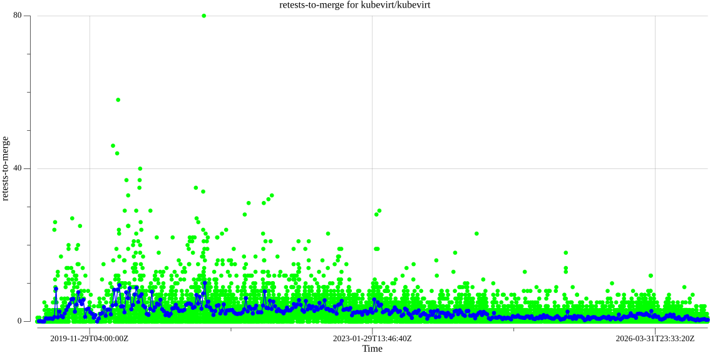
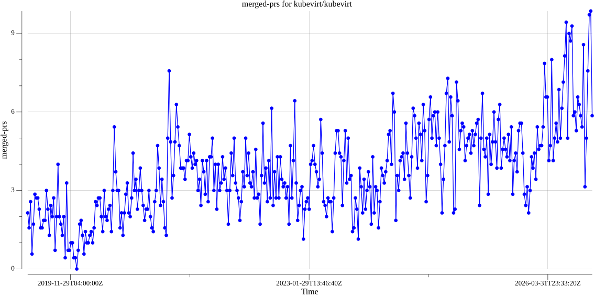
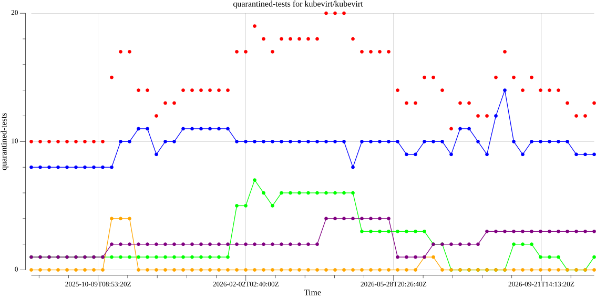

# ci-health


This repo contains code to calculate metrics about the performance of CI systems
based on Prow.

## Documentation

* [Metric definitions](#definitions) and [current status](#status)
* [Code layout](#code-layout) and [development checks](#development)
* [Commands](#commands) and [local execution](#local-execution)
* [Automation and workflows](#automation--workflows)
* [CI analysis skills and CLI setup](docs/skills-overview.md)

## Definitions

* Merge queue: list of Pull Requests that are ready to be merged at any given
date. For being ready to be merged they must:

  * Have the `lgtm` label.
  * Have the `approved` label.
  * Not have any label matching `do-not-merge/*`, i.e. `do-not-merge/hold`,  `do-not-merge/work-in-progress` etc. .
  * Not have any label matching `needs-*`, i.e. `needs-rebase`, `needs-ok-to-test` etc. .

* Merge queue length: number of PRs in the merge queue at a given time.
* Time to merge: for each merged PR, the time in days it took since it entered the merge
queue for the last time until it got finally merged.
* Retests to merge: for each merged PR, how many `/test` and `/retest` comments
were issued after the last code push.

## Status
This status is updated every 3 hours. The average values are calculated with
data from the previous 7 days since the execution time.

### kubevirt/kubevirt


[Latest execution data](https://kubevirt.io/ci-health/output/kubevirt/kubevirt/results.json)

[Latest weeks data](https://grafana.ci.kubevirt.io/d/WZU1-LPGz/merge-queue)

### Failures per SIG against last code push for merged PRs

These badges display the number of failures per SIG against merged PRs from the last 7 days.

Each of these failures contribute to the number of retests that occur in CI and delay the time to merge for PRs.

[](https://storage.googleapis.com/kubevirt-prow/reports/sig-failure-reports/sig-compute-failure-report.html)
[](https://storage.googleapis.com/kubevirt-prow/reports/sig-failure-reports/sig-storage-failure-report.html)
[](https://storage.googleapis.com/kubevirt-prow/reports/sig-failure-reports/sig-network-failure-report.html)
[](https://storage.googleapis.com/kubevirt-prow/reports/sig-failure-reports/sig-operator-failure-report.html)
[](output/kubevirt/kubevirt/ci-failures/summary.md)
[](output/kubevirt/kubevirt/ci-failures/summary.md)
[](https://storage.googleapis.com/kubevirt-prow/reports/sig-failure-reports/sig-monitoring-failure-report.html)


### Quarantined Tests Per SIG

These badges display the number of tests that are currently quarantined per SIG.

More details on these tests can be found [here](https://storage.googleapis.com/kubevirt-prow/reports/quarantined-tests/kubevirt/kubevirt/index.html)


Top failed lanes:


The links to each of these failed jobs can be found in the [latest execution data](https://kubevirt.io/ci-health/output/kubevirt/kubevirt/results.json)
under the SIGRetests section

## Historical data evolution

These plots will be updated every week.

* kubevirt/kubevirt merge queue length:
  

  Data available [here](./output/kubevirt/kubevirt/batch/merge-queue-length/data).

* kubevirt/kubevirt time to merge:
  

  Data available [here](./output/kubevirt/kubevirt/batch/time-to-merge/data).

* kubevirt/kubevirt retests to merge:
  

  Data available [here](./output/kubevirt/kubevirt/batch/retests-to-merge/data).

* kubevirt/kubevirt merged PRs per day:
  

  Data available [here](./output/kubevirt/kubevirt/batch/merged-prs/data).

* kubevirt/kubevirt quarantined tests over time (by SIG):
  

  Legend: Red(Total) | Blue(Compute) | Green(Storage) | Orange(Network) | Purple(Monitoring)

  Data available [here](./output/kubevirt/kubevirt/batch/quarantined-tests/data).

## Code layout

The CLI entry points live in [cmd/](cmd/); see [Commands](#commands) for their
roles and [Local execution](#local-execution) for usage. Shared logic lives in
[pkg/](pkg/):

* [chatops/](pkg/chatops/) analyzes `/test` and `/retest` comments;
  [mergequeue/](pkg/mergequeue/) determines merge-queue membership.
* [stats/](pkg/stats/) calculates statistics, while [metrics/](pkg/metrics/)
  exposes metrics in Prometheus format.
* [gh/](pkg/gh/) provides the GitHub API client; [runner/](pkg/runner/)
  coordinates the stats and batch operations.
* [sigretests/](pkg/sigretests/) attributes failures and retests to SIGs;
  [quarantine/](pkg/quarantine/) collects quarantined-test statistics.
* [ci-failures/](pkg/ci-failures/) implements build-log analysis, error
  categorization and clustering, test and lane failure rates, and Kubernetes
  artifact analysis.
* [htmlreport/](pkg/htmlreport/) parses JUnit reports and renders per-SIG HTML
  reports using an embedded template.
* [output/](pkg/output/) writes JSON results, SVG badges, and Prometheus metrics;
  [plot/](pkg/plot/) generates historical PNG plots.
* [prow/](pkg/prow/) defines Prow job metadata; [types/](pkg/types/) contains
  shared options, metrics, PR, and result types.
* [constants/](pkg/constants/) defines shared names and defaults;
  [timeutils/](pkg/timeutils/) provides date helpers.

## Development

Use the Go version and toolchain specified in [go.mod](go.mod). From the
repository root, install the PromQL test tool, then run the unit tests, static
checks, and build:

```bash
sh hack/install-promtool.sh "$HOME/.local/bin"
export PATH="$HOME/.local/bin:$PATH"
go test ./cmd/... ./pkg/...
go vet ./...
go build ./...
golangci-lint run ./...
```

The cost query tests require **promtool 3.5.0** (from Prometheus), installed by
the script above with pinned archive checksums. The installer requires `curl`,
`tar`, and `sha256sum` (or `shasum` on macOS), and supports Linux and macOS on
amd64 and arm64. CI installs the same version before running the tests. Once
installed, `go test ./pkg/cost -run TestCostPromQL -v` needs no network access,
cluster, or credentials; a missing tool fails the tests instead of skipping
validation.

These tests capture all six actual HTTP query strings from `GetClusterCapacity`
and `GetJobMetrics`, then use Prometheus's parser and engine through
[`promtool test rules`](https://prometheus.io/docs/prometheus/latest/configuration/unit_testing_rules/).
The [synthetic fixture](pkg/cost/testdata/promql.yaml.tmpl) contains series and
expected values and labels, with expressions injected from those requests to
prevent drift. It covers node and namespace filtering, container exclusions,
pod aggregation, Prow labels, and different time windows. A malformed-query
control verifies that the same validation reports a PromQL parse error.

The lint configuration is [.golangci.yml](.golangci.yml). Tests alongside the
packages use Go's testing package and Ginkgo/Gomega; follow the conventions in
the package being changed.

The [end-to-end suite](e2e/tests_suite_test.go) queries live GitHub data and
requires `GITHUB_TOKEN_PATH` to point to an OAuth token file. With that
prerequisite configured, `go test ./...` also runs the end-to-end suite, as in
the [test workflow](.github/workflows/ci-health-tests.yaml).

## Commands

The repository provides four CLI tools under `cmd/`:

* `stats`: gathers latest data and generates badges data and files.
* `batch`: gathers data for a range of dates and generates plots from them.
* `html-report`: generates per-SIG HTML failure reports.
* `ci-failures`: diagnostic CLI for analyzing CI build failures, test flakiness, and Kubernetes cluster state.

## Automation & Workflows

The repository uses GitHub Actions and a Prow postsubmit to automate data collection and report generation.

The central artifact is `output/kubevirt/kubevirt/results.json`: `badges-update.yaml` produces it every 3 hours, and its commit to `main` triggers both `ci-failures.yml` and the `ci-health-sig-report-publish` Prow postsubmit.

### GitHub Actions

| Workflow                                                               | Trigger                                                    | Purpose                                                              |
| ---------------------------------------------------------------------- | ---------------------------------------------------------- | -------------------------------------------------------------------- |
| [badges-update.yaml](.github/workflows/badges-update.yaml)             | Every 3 hours or manual dispatch                           | Runs `stats`, commits updated badges and `results.json`              |
| [ci-failures.yml](.github/workflows/ci-failures.yml)                   | Push to `main` modifying `results.json`                    | Runs `ci-failures generate report`, commits updated Markdown summary |
| [ci-health-tests.yaml](.github/workflows/ci-health-tests.yaml)         | PR modifying `cmd/`, `pkg/`, `e2e/`, `go.*`, or `.github/` | Runs `go test ./...`, including the end-to-end suite                 |
| [historical-update.yaml](.github/workflows/historical-update.yaml)     | Weekly (Monday 00:10 UTC) or manual dispatch               | Runs `batch` fetch+plot for trend metrics, commits updated plots     |

### Prow Postsubmit

**`ci-health-sig-report-publish`** ([definition](https://github.com/kubevirt/project-infra/blob/main/github/ci/prow-deploy/files/jobs/kubevirt/ci-health/ci-health-postsubmits.yaml)):
Triggers when `results.json` changes on `main`. Generates per-SIG HTML failure reports and uploads them to `gs://kubevirt-prow/reports/sig-failure-reports/`.

## Local execution

### Requirements

* Go v1.26+
* A GitHub token with `public_repo` permission (required for `stats`, `batch`, and `html-report`; not needed for `ci-failures`)

### stats command

A generic stats command execution from the repo's root looks like:
```
$ go run ./cmd/stats --gh-token /path/to/token --source <org/repo> --path /path/to/output/dir --data-days <days-to-query>
```
where:
* `--gh-token`: should contain the path of the file where you saved your GitHub
token.
* `--source`: is the organization and repo to query information from.
* `--path`: is the path to store output data.
* `--data-days`: is the number of days to query.

You can check all the available options with:
```
$ go run ./cmd/stats --help
```
So, for instance, if you have stored the path of your GitHub token file in a
`GITHUB_TOKEN` environment variable, a query for the last 7 days of
kubevirt/kubevirt can look like:
```
$ go run ./cmd/stats --gh-token ${GITHUB_TOKEN} --source kubevirt/kubevirt --path /tmp/ci-health --data-days 7
```

### batch command

batch executions are done in two modes:
* `fetch`: gathers the data
* `plot`: generates a png file with the data previously fetched.

A generic fetch batch command execution from the repo's root looks like:
```
$ go run ./cmd/batch --gh-token /path/to/token --source <org/repo> --path $(pwd)/output --mode fetch --target-metric merged-prs --start-date 2020-05-19
```
where:
* `--gh-token`: should contain the path of the file where you saved your GitHub
token.
* `--source`: is the organization and repo to query information from.
* `--path`: is the path to store output data.
* `--target-metric`: is the metric to query.
* `--start-date`: is the oldest date from which the data will be queried, until today.

You can check all the available options with:
```
$ go run ./cmd/batch --help
```
To generate plots you should execute:
```
$ go run ./cmd/batch --gh-token /path/to/token --source <org/repo> --path $(pwd)/output --mode plot --target-metric merged-prs --start-date 2020-05-19
```
Plot mode requires data previously generated by fetch mode.

### html-report command

A command that generates HTML reports of test case failures per SIG. To create a report for SIG Compute failures:
```
$ go run ./cmd/html-report --sig compute --results-path ./output/kubevirt/kubevirt/results.json --path /tmp/
```

This should create a HTML report called sig-compute-failure-report.html under /tmp/.

### ci-failures command

A diagnostic CLI for analyzing CI failures in KubeVirt's Prow-based CI system. It downloads build logs and artifacts from GCS, categorizes errors, computes test flakiness rates, and analyzes Kubernetes cluster state from k8s-reporter dumps.

For installation, executable `PATH`, runtime prerequisites, and session handling,
see [CLI installation and setup](docs/skills-overview.md#cli-installation-and-setup).
The skills use the installed `ci-failures` binary; the examples below use
`go run ./cmd/ci-failures` for execution directly from a source checkout.

All output is written as YAML to `output/tmp/` by default. Use `--session-id` (or set `CLAUDE_CODE_SESSION_ID`) to isolate output into `output/tmp/sessions/<id>/`.

Currently supports the `kubevirt` GitHub organization only.

#### analyze-build

Analyze a single Prow job failure. Downloads the build log, extracts error snippets, categorizes them, and also runs k8s cluster state analysis if artifacts are available.

```
$ go run ./cmd/ci-failures analyze-build <prow-job-url>
```

Example:
```
$ go run ./cmd/ci-failures analyze-build \
    https://prow.ci.kubevirt.io/view/gs/kubevirt-prow/pr-logs/pull/kubevirt_kubevirt/17287/pull-kubevirt-e2e-k8s-1.31-sig-compute/2045831803410845696
```

Errors are classified into the following categories:

| Category | Description |
|---|---|
| `external` | Infrastructure failures outside CI team's control (download errors, DNS, image pulls) |
| `internal` | CI configuration errors fixable by sig-ci |
| `pr-build` | Build/test failures caused by the PR code itself |
| `prow-aborted` | Jobs aborted by Prow (e.g. newer commit pushed) |
| `prow-error` | Jobs that could not be scheduled or started |
| `needs-investigation` | Errors that don't match any known pattern |

#### analyze-pr

Analyze all failed builds for a GitHub pull request. Lists failed Prow jobs via the GitHub API and runs `analyze-build` on each one.

```
$ go run ./cmd/ci-failures analyze-pr <github-pr-url>
```

Example:
```
$ go run ./cmd/ci-failures analyze-pr https://github.com/kubevirt/kubevirt/pull/17287
```

#### analyze-k8s

Analyze Kubernetes cluster state from k8s-reporter artifacts for a Prow job. Downloads pods, nodes, events, and KubeVirt object dumps from GCS, then runs failure detectors for CrashLoopBackOff, OOMKilled, NotReady nodes, warning events, failed VMI migrations, and etcd issues.

```
$ go run ./cmd/ci-failures analyze-k8s <prow-job-url>
```

#### test-rate

Look up historical success rates for tests that failed in a Prow build. Uses kubevirt flakefinder reports to classify each failure as likely-pr-related (>= 95% success rate), inconclusive (>= 80%), or likely-flaky (< 80%).

```
$ go run ./cmd/ci-failures test-rate <prow-job-url>
```

Flags:
* `--days`: number of days to analyze (1-28, default 7). Fetches multiple weekly flakefinder reports as needed.

#### lane-rate

Analyze a testgrid lane and show failure rates for every test with at least one failure.

```
$ go run ./cmd/ci-failures lane-rate <testgrid-url>
```

Example:
```
$ go run ./cmd/ci-failures lane-rate \
    https://testgrid.k8s.io/kubevirt-periodics#periodic-kubevirt-e2e-k8s-1.36-sig-storage
```

Flags:
* `--days`: analysis window in days (default 14).
* `--max-success-rate`: only include tests at or below this success rate, 0-100 (default 100).

#### flake-overview

Combined project-wide flake analysis that aggregates flakefinder PR failure data with testgrid periodic lane rates into a single YAML report.

```
$ go run ./cmd/ci-failures flake-overview
```

Flags:
* `--days`: analysis window in days (default 14).
* `--filter-lane-regex`: regex for lanes to exclude (default `.*-root$`).
* `--concurrency`: parallel testgrid fetches (default 6).

#### change-relevance

Check whether a PR's code changes overlap with the SIG code areas of tests that failed in a build.

```
$ go run ./cmd/ci-failures change-relevance <prow-job-url>
```

#### discover-lanes

Query testgrid for all lanes matching a given Kubernetes version across the kubevirt-periodics and kubevirt-presubmits dashboards.

```
$ go run ./cmd/ci-failures discover-lanes <version>
```

Example:
```
$ go run ./cmd/ci-failures discover-lanes 1.36
```

#### show-log

Print the decoded build log content from a cached build log YAML file.

```
$ go run ./cmd/ci-failures show-log <build-id>
```

Flags:
* `--tail`: print only the last N lines (default 0 = all).
* `--grep`: filter lines matching a pattern (case-insensitive).

#### generate report

Generate YAML failure reports and a Markdown summary from recent CI failures.

```
$ go run ./cmd/ci-failures generate report
```

Sub-commands:
* `generate yaml`: generate YAML failure reports only.
* `generate md`: generate Markdown summary from existing YAML files.
* `generate report`: generate both YAML and Markdown.

Output: `output/kubevirt/kubevirt/ci-failures/summary.md`

#### summarize-session

Output a condensed YAML summary of all analysis files produced during a session. Requires a session ID.

```
$ go run ./cmd/ci-failures summarize-session --session-id <id>
```
