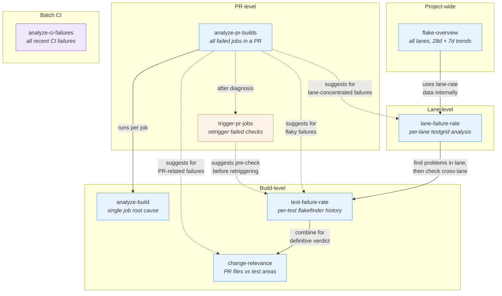

# CI Health Skills Overview

Skills in `.claude/skills/` provide CI failure analysis, flake detection, and PR triage for the KubeVirt project. Load them through your agent's skill mechanism (for example, Claude Code slash commands or Kilo's skill tool).

## CLI Installation and Setup

The diagnostic skills use the installed `ci-failures` Go CLI, not `go run`
on every invocation. Install Go 1.26 or newer; this checkout declares Go
1.26.0 and selects toolchain go1.26.4. Go may download the selected toolchain
automatically when toolchain switching is enabled.

Install from a local ci-health checkout. If you do not already have one,
clone the repository into your chosen workspace:

```bash
git clone https://github.com/kubevirt/ci-health.git
```

Run the following from the checkout's root. For reproducibility, select a
verified commit before installing; otherwise use an up-to-date `main` checkout.

```bash
go install ./cmd/ci-failures
```

Do not use `go install github.com/kubevirt/ci-health/cmd/ci-failures@latest`
or `@main` for this repository. Versioned module installation is currently
blocked by historical output filenames containing `:` that Go rejects when
building a module archive. Installing from a Git checkout avoids that archive
validation; it also provides the input data needed by the batch-analysis skill.

Go installs executables into `GOBIN`, or the `bin` directory under `GOPATH`
when `GOBIN` is unset (normally `$HOME/go/bin`). Inspect the effective values:

```bash
go env GOBIN GOPATH
```

Put that executable directory on `PATH`. For the default location:

```bash
export PATH="$HOME/go/bin:$PATH"
command -v ci-failures
ci-failures --help
```

If a documented subcommand or flag is missing, reinstall using one of the
commands above and check its help before proceeding.

### Working Directory and Dependencies

Run the skill commands from a writable ci-health checkout root so relative
inputs, generated reports, and caches have a consistent location. An installed
binary does not require Go at runtime. URL-based analyses can also run from
another writable working directory, but `generate yaml` specifically requires
`output/kubevirt/kubevirt/results.json` from the ci-health checkout.

Analysis downloads use public GCS, Prow, and TestGrid endpoints; they do not
require `gcloud`, `gsutil`, or Kubernetes cluster credentials. GitHub REST
requests can use `GITHUB_TOKEN` for authentication and higher rate limits.
The code/issue searches in the flake skills and the `trigger-pr-jobs` skill
additionally require the GitHub CLI (`gh`) with an authenticated account.
Retriggering also requires permission to comment on the target PR.

### Sessions and Output

Use a fresh session ID for each independent analysis and the same ID for all
commands belonging to it. The CLI does not create an ID automatically:

```bash
ci-failures --session-id pr-17287-review-1 analyze-pr https://github.com/kubevirt/kubevirt/pull/17287
ci-failures --session-id pr-17287-review-1 summarize-session
```

Session IDs must not contain `..`, `/`, or `\`. The explicit `--session-id`
flag takes precedence over the `CLAUDE_CODE_SESSION_ID` environment variable.
`summarize-session` requires one of these to be set and reads all analysis
files already present in that session; do not reuse a session for another PR.

In the skill instructions, `<output-dir>` means `output/tmp` without a session,
or `output/tmp/sessions/<session-id>` when a session is configured. Read the
exact output paths printed by each command rather than guessing filenames or
reading files left by a previous run. Shared build-log caches remain under
`output/tmp/build-logs/` even when sessions are enabled. Do not delete the
entire `output/tmp` tree to refresh one analysis; it contains other sessions
and shared caches.

`flake-overview` writes the same filename on repeated runs within a session.
Read the first analysis window before running the second, or use separate
session IDs for the two windows.

### Skill Discovery

Keep the definitions in this checkout's `.claude/skills/` canonical. Configure
your agent to load this directory directly; existing shared-directory symlinks
are aliases, not separate copies. For Kilo, add the absolute path to this
directory to `skills.paths` in `kilo.json` and verify with `kilo debug skill`
in a fresh process. When using a worktree, register its skill directory to
test the edited definitions rather than the original checkout's versions.

## Skills by Scope

| Scope             | Skills                                                       | Input                 |
| ----------------- | ------------------------------------------------------------ | --------------------- |
| **Single build**  | `analyze-build`, `test-failure-rate`, `change-relevance`     | Prow job URL          |
| **Single PR**     | `analyze-pr-builds`, `trigger-pr-jobs`                       | GitHub PR URL         |
| **All recent CI** | `analyze-ci-failures`, `lane-failure-rate`, `flake-overview` | No URL / testgrid URL |

## Skill Descriptions

### analyze-build

Deep root-cause analysis of one failed Prow job. Extracts build log errors, k8s cluster state (pods, nodes, events, VMIs), etcd profiling, and container logs. Classifies as infrastructure flake vs. test failure.

**Input:** A Prow job URL pointing to a specific build, e.g.
`https://prow.ci.kubevirt.io/view/gs/kubevirt-prow/pr-logs/pull/kubevirt_kubevirt/16885/pull-kubevirt-e2e-k8s-1.34-windows2016/2034979182789791744`

### analyze-ci-failures

Batch analysis of all recent CI failures from `results.json`. Groups failures by root cause across SIGs, detects cross-PR flakes, and identifies infrastructure events within time windows.

**Input:** None — operates on the pre-existing `output/kubevirt/kubevirt/results.json` data file in the ci-health repository.

### analyze-pr-builds

Analyzes all currently-failing builds for a PR. Runs build-level analysis across every failed job, then correlates cross-job patterns (same test in many jobs suggests PR-caused; different tests suggest flakes).

**Input:** A GitHub pull request URL, e.g.
`https://github.com/kubevirt/kubevirt/pull/17287`

### test-failure-rate

Looks up historical success rates for a build's failed tests using flakefinder data. Classifies each test as flaky, PR-related, or infrastructure-related by analyzing dispersion across lanes and k8s versions.

**Input:** A Prow job URL pointing to a specific build (same format as `analyze-build`). Optional `--days` flag (default 7, max 28) to extend the analysis window.

### change-relevance

Maps a PR's changed files to SIG code areas, then checks whether the failing tests overlap those areas. Classifies each failure as `related`, `possibly-related`, `unrelated`, or `unknown`. Only works for PR builds (URLs containing `pr-logs/pull/`); periodic builds are not supported.

**Input:** A Prow job URL for a PR build, e.g.
`https://prow.ci.kubevirt.io/view/gs/kubevirt-prow/pr-logs/pull/kubevirt_kubevirt/17760/pull-kubevirt-e2e-kind-1.35-sig-compute-arm64/2053843644594524160`

### lane-failure-rate

Lane-wide analysis from testgrid. Computes per-test failure rates for every test in a lane, with flip-rate analysis, burst detection, and cross-test correlation. Includes a `discover-lanes` subcommand for finding all lanes matching a k8s version.

**Input (lane-rate):** A testgrid URL identifying a lane, e.g.
`https://testgrid.k8s.io/kubevirt-periodics#periodic-kubevirt-e2e-k8s-1.36-sig-storage`
Optional `--days` flag (default 14) and `--max-success-rate` filter (useful for noisy presubmit lanes).

**Input (discover-lanes):** A Kubernetes version string, e.g. `1.36`. Returns all matching periodic and presubmit lanes.

### flake-overview

Project-wide flake report combining flakefinder (PR-based) and testgrid (periodic) data. Runs 28-day and 7-day windows for trend detection, resolves test source locations, and produces a markdown report grouped by SIG with quarantine prioritization.

**Input:** None — fetches flakefinder and testgrid data automatically. Uses a `--days` flag (run twice: once with `--days 28`, once with `--days 7`) to produce the two windows needed for trend comparison.

### trigger-pr-jobs

Operational skill: finds missing or failed required checks on a PR and posts `/test` commands to retrigger them.

**Input:** A GitHub pull request URL, e.g.
`https://github.com/kubevirt/kubevirt/pull/17287`

## How the Skills Relate



### Key Relationships

- **`analyze-pr-builds` is the PR entry point** — it runs `analyze-build` on every failed job in a PR, then suggests three follow-up skills depending on what it finds.
- **`test-failure-rate` + `change-relevance` form a decision matrix** — together they answer "is this test historically flaky?" and "did this PR touch the test's code area?" The `change-relevance` skill includes a combined verdict table mapping all combinations.
- **`lane-failure-rate` feeds into `test-failure-rate`** — lane-failure-rate finds which tests are problematic in a lane; test-failure-rate then checks if those tests also fail across other lanes.
- **`flake-overview` aggregates `lane-failure-rate`** — it runs lane-rate analysis across all lanes and combines it with flakefinder data to produce a project-wide quarantine-prioritized report.
- **`trigger-pr-jobs` is the only action skill** — the others are diagnostic. It suggests running `test-failure-rate` first to decide whether retriggering is worthwhile.
- **`analyze-ci-failures` stands alone** — it operates on all recent CI failures from `results.json` rather than a specific build or PR.
